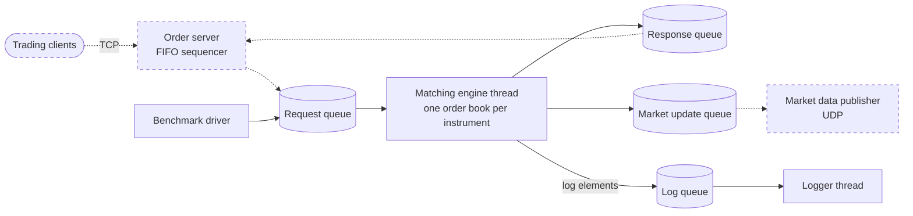

# Low-Latency Trading Exchange (C++20)

A matching engine for a simulated exchange, written in C++20, together with the building blocks it
runs on (lock-free queue, memory pool, asynchronous logger, thread pinning, TCP sockets).

## Status

| Part | Status |
|---|---|
| Matching engine and order book | Done, benchmarked |
| Building blocks in `common/` | Done |
| Order server (TCP gateway, FIFO sequencer) | In progress, not in the build yet |
| Market data publisher (UDP, incremental and snapshot) | Message types only |
| Trading client (market data consumer, order gateway, strategies) | Not started |

## Result

Time per request inside the matching engine, in nanoseconds:

| | mean | p50 | p90 | p99 | p99.9 |
|---|---|---|---|---|---|
| Request processing | 86 | 74 | 144 | 247 | 352 |

- **What is measured:** from the engine reading a request off its queue to having written and
  published every client response and market update for it. Time spent waiting in the queue is
  not included.
- **Workload:** 500,000 random requests (seed 42) over 8 instruments and 16 clients. About 75% are
  new limit orders with prices 1-256 and quantity 1-100. About 25% cancel an earlier order, which
  has often been filled already, so the cancel is rejected. The first 200,000 requests are sent back
  to back and the rest one every 100 ns. The results of the first 50,000 requests are discarded as
  warm-up. Nothing reads the output queues.
- **Machine:** Intel i7-14650HX laptop, Ubuntu 26.04.1, CMake Release build (`-O3`). The engine, its
  logger and the benchmark driver each run on their own isolated physical core (`isolcpus`,
  `nohz_full`, `rcu_nocbs`), which leaves 2-7 interrupts on the engine's core per run. 2 MB pages
  and no address randomisation keep the memory layout the same between runs.
- **Run:** commit `ee4121a`, one run. Repeat runs gave similar numbers.

Sent back to back, requests queue up and the engine runs with warm caches, which measures lower than
a request arriving at an idle engine. With requests 10 µs apart and the driver polling the output
queues the way the order server will, the engine measured p50 84, p90 160 and p99 301 ns.

Full setup, including what each kernel boot parameter does:
[results.md](benchmarks/matching-engine-benchmark/results.md). How to run it:
[benchmark README](benchmarks/matching-engine-benchmark/README.md).

## How it works



Solid boxes are built, dashed ones are planned. Every queue is single-producer, single-consumer,
and each thread is pinned to its own core. Until the order server and market data publisher are
finished, the benchmark stands in for them: its driver sends requests and reads the responses like
the order server, and a thread on its own core reads the market updates.

**Order book.** One per instrument. Each side is an array of price levels indexed directly by price,
with a sentinel level at each end. Each level is a circular doubly linked list of orders in arrival
order. An incoming order matches against the opposite side at the resting order's price until it is
filled or the prices no longer cross, and any remainder rests in the book. Cancels find the order
through a `[client][client order id]` array, so they are O(1).

**Next best price.** A bitmap per side marks the non-empty levels. When the best level empties, the
next one is `std::countr_zero` (asks) or `std::countl_zero` (bids) on the first non-zero 64-bit word,
at most 5 words for 256 levels.

**Sentinels.** Level 0 holds a bid and level 257 an ask that can never match, and their bits are
always set. The best order on a side is never null, so the matching loops need no empty-side check
and the bitmap search always finds a bit.

**Queues** (`common/lf-queue.h`). The capacity is a compile-time power of two, so a slot is
`counter & mask`. The write and read counters sit on separate cache lines, and no counter is written
by both threads: the producer publishes with a release store and the consumer reads it with an
acquire load. The consumer caches the last write index it saw and only rereads it when it catches
up, so draining a batch doesn't pull the producer's cache line on every element. The producer can
fill several slots and publish them with one store. A full queue makes the producer wait
(backpressure). The producer likewise caches the read index and only rereads it when the queue
looks full, and waits with `pause` between checks.

**Publishing.** The engine stages all responses and market updates for a request and publishes each
queue once per request. A fill produces 2 responses and 2 market updates.

**Memory.** Orders come from `common/memory-pool.h`, a fixed pool whose free slots are a stack of
indices. Allocate and free are O(1), and the most recently freed slot, likely still in cache, is
reused first. Pools and queues are allocated and touched at start-up, and the hot path does not
allocate.

**Logging.** The engine pushes typed binary elements (a number, or up to 8 characters of a string)
onto a queue. A separate logger thread formats them and writes the file. Each benchmark measurement
is one log line.

## Changes from the book

Where this repo differs from the design in the book (see [Credits](#credits)). Numbers are from the
[optimisation log](#optimisation-log), measured at the time.

| Part | Book | This repo | Measured effect |
|---|---|---|---|
| Price levels | Allocated from a pool and kept in a sorted linked list. A new level walks the list to find its place | Fixed array per side indexed by price, bitmap of non-empty levels, sentinel levels | Bitmap vs my earlier linear scan: order removal p90 43-50 → 35-38 ns |
| Queue | Atomic read and write indexes plus an element count that both threads update, `%` to wrap | Power-of-two capacity, counters on separate cache lines, cached write index, release/acquire only | Measured together with the logger change below |
| Logger | One queue element per character | Up to 8 characters per element, one publish per line | Queue and logger together: p50 2,722 → 486 ns, p99 31,311 → 2,177 ns |
| Memory pool | Scans for the next free block | Stack of free indices | Slowest order insertion 22-29 µs → 2.7-3.7 µs. The rest unchanged |
| Publishing | One queue publish per message | One per queue per request | p90 276 → 164 ns, p99 502 → 314 ns |
| Sweeps | Each filled order is unlinked from its level | The level is relinked once after a sweep | No measurable difference. Kept, it does less work |

## Optimisation log

The changes in order, with the numbers measured at the time. The workload and machine setup changed
along the way, so compare numbers within a phase, not across phases. All values are nanoseconds.

**Phase 1: dense book, every code block measured.** 100,000 requests 500 µs apart, prices 101-110,
no core isolation.

| Commit | Change | p50 | p90 | p99 |
|---|---|---|---|---|
| `20c7a60` | Baseline | 8,879 | 51,617 | 236,320 |
| `7f22e7a` | Removed text log lines from the hot path (a `std::stringstream` and ~260 characters per message) | 2,722 | 8,858 | 31,311 |
| `0d36b92`, `26b366e` | Queue and logger rewrite | 486 | 1,293 | 2,177 |
| `d212993`..`ccba682` | Memory pool free list | unchanged | unchanged | unchanged |

**Phase 2: sparse book.** 500,000 requests 10 µs apart, prices 1-256, the driver polling the output
queues.

| Commit | Change | Effect |
|---|---|---|
| `0ce11e6` | Bitmap search for the next best price | Order removal p90 43-50 → 35-38 |
| `31ac48a` | Detailed measurements taken out of the hot path. Each one cost the engine ~60-70 ns of logging, so the numbers were mostly measuring the measurements | p50 / p90 / p99: 380 / 1,128 / 2,065 → 86 / 302 / 530 |
| Boot parameters | Core isolation | Interrupts on the engine's core per run: ~6,200 → 2-7. Latency unchanged at this load |
| `6aa4733` | Publish once per request | p90 276 → 164, p99 502 → 314 |
| `064c0f0` | Experiment: queue with a mutex and condition variable | Mean 104 → 2,460. Rolled back in `7d60304` |

**Phase 3: current benchmark.** `1fe7145` sends requests back to back instead of 10 µs apart and
stops reading the output queues. `ee4121a` paces requests after the first 200,000, and brackets each
measurement with `lfence; rdtsc; lfence` and `rdtscp; lfence` so the out-of-order core can't move
instructions across the edges of the measured block. The numbers in [Result](#result) are from this
phase.

## Measuring

- One RDTSC measurement per request, around processing and publishing, written to the engine's log
  through the asynchronous logger. `scripts/perf-analysis.py` converts cycles to nanoseconds using
  the TSC frequency from the kernel log and prints count, mean and percentiles.
- Throughput is measured by the benchmark driver, with no code in the engine: the time from the
  first request sent to the last request's responded, divided by the number of requests.
- The per-block measurements (`add`, `cancel`, `match`, ...) and the queue hop timestamps are
  commented out in the code. They can be turned back on for a closer look, at the logging cost above.
- `run-benchmark.sh` rebuilds, runs with a fixed memory layout, analyses the log and appends a row to
  [`results.csv`](benchmarks/matching-engine-benchmark/results.csv) with the commit and a fingerprint
  of any uncommitted changes, so every recorded number can be traced to the code that produced it.

## Build and run

Requires Linux (thread pinning, epoll), a C++20 compiler (builds with GCC 13), CMake 3.16+, Python 3,
and about 2 GB of RAM: each of the 8 order books holds a 128 MiB order index and a 72 MiB order pool.

```bash
cd exchange/matching-engine
cmake -B cmake-build-release           # Release (-O3) unless CMAKE_BUILD_TYPE is set
cmake --build cmake-build-release -j   # builds exchange_main and matching_engine_benchmark
```

Run the benchmark, analyse it and record the result, from the repo root:

```bash
sudo benchmarks/matching-engine-benchmark/prepare-machine.sh   # once per boot, pins the uncore clock
benchmarks/matching-engine-benchmark/run-benchmark.sh
benchmarks/matching-engine-benchmark/run-benchmark.sh --price-min 101 --price-max 110   # dense book
```

The default cores (engine 4, logger 6, driver 8, market data publisher stand-in 10) fit an
i7-14650HX. On another machine, pick four different physical cores with `--engine-core`,
`--logger-core`, `--driver-core` and `--mdp-core`, or pass `-1` to leave a thread unpinned. If the kernel log isn't readable, run `scripts/perf-analysis.py` by hand
with `--tsc-ghz`. All options and how to prepare the machine are in the
[benchmark README](benchmarks/matching-engine-benchmark/README.md).

## Repository layout

```
common/                                building blocks: lf-queue, memory-pool, logging, thread-utils,
                                       tcp-socket, tcp-server, perf-utils (RDTSC), time-utils
exchange/matching-engine/              matcher/ (engine thread), order-book/, CMakeLists.txt, main
exchange/order-server/                 client request and response messages, FIFO sequencer,
                                       order server (in progress)
exchange/market-data/                  market update messages
benchmarks/matching-engine-benchmark/  benchmark driver, run script, results.md, results.csv
benchmarks/*.cpp                       compiler optimisation experiments (pointer aliasing,
                                       loop-invariant code motion)
examples/                              small programs that exercise each building block
scripts/perf-analysis.py               log analysis
ToDo.txt                               planned compiler and hardware experiments
```

## Limitations

- The order server and market data publisher are stand-ins in the benchmark. They read the
  engine's output queues with a 16 µs busy wait per loop for their syscalls, an estimate, and the
  numbers depend on it.
- Prices are not validated before they reach the order book. A price outside 1-256 would index past
  the level arrays or match a sentinel.
- The price range is fixed at 256 ticks per instrument, with 8 instruments.
- The order index is a dense `[client][order id]` array of pointers, 128 MiB per order book and
  mostly empty. I suspect its cache misses drive part of the p99.9 tail. Not confirmed.
- Limit orders and cancels only. No modify, market or IOC orders.
- No automated correctness tests yet.
- Measured on one laptop.

## Next steps

- Finish the order server, then the market data publisher and a trading client, to measure from a
  TCP packet in to a response out.
- A deterministic correctness test: a fixed request stream checked against the expected fills and
  market updates.
- Restructure the `[client][order id]` array, which is 128 MiB per order book and mostly empty,
  into a smaller order index, and measure the change against the p99.9 tail.
- Price validation.
- The compiler and hardware experiments in [`ToDo.txt`](ToDo.txt).

## Credits

The architecture follows Sourav Ghosh's *Building Low Latency Applications with C++* (Packt, 2023).
I built it while working through the book, then changed the order book, queue, memory pool, logger
and publishing path, measuring each change. See [Changes from the book](#changes-from-the-book).
The book's code is at
[PacktPublishing/Building-Low-Latency-Applications-with-CPP](https://github.com/PacktPublishing/Building-Low-Latency-Applications-with-CPP)
under the MIT license.
