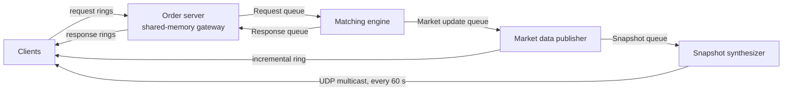

# Low-Latency Trading Exchange (C++20)

A simulated exchange in C++20 on Linux: a matching engine, an order server, and a market data publisher with incremental and snapshot streams. Clients send orders and read their responses and the incremental market data through shared memory, and snapshots go out over UDP multicast. In the benchmarks each component runs on its own isolated core, and they talk over lock-free single-producer, single-consumer queues.

## Status

| Part | Status |
| --- | --- |
| Matching engine and order book | Done, benchmarked on its own |
| Order server (shared-memory gateway) | Done, benchmarked end to end |
| Market data publisher, incremental stream (shared memory) | Done, benchmarked end to end |
| Snapshot synthesizer and snapshot stream (UDP multicast) | Built |
| Shared-memory transport (`common/shared-region.h`, order and market data channels) | Done |
| Building blocks in `common/` | Done |
| Trading client (market data consumer, order gateway, strategies) | To be completed |

## How it works



## Result

End to end, a request gets its final response in 1.0 µs at p50 and 3.8 µs at p99, at 100,000 requests/s from 255 clients. Inside the matching engine alone, a request takes 90 ns at p50 and 288 ns at p99.

### Exchange, end to end

Microseconds, measured by the client, from a request going into its client's shared-memory ring to:

| Until | p50 | p90 | p99 |
| --- | --- | --- | --- |
| its final response | 1.0 | 1.2 | 3.8 |
| the market update it caused (ADD or CANCEL) | 1.0 | 1.1 | 3.7 |

- **Workload:** 255 clients, each with its own slot in the order server's shared memory. 1,000,000 requests sent open loop at 100,000 a second for 10 s: request i is due at start + i / rate, whether or not earlier ones were answered. A client cancels each of its orders after 50 more of its own requests. Prices uniform in 1-256, quantities 1-1000, seed 42. The first 10% of requests are not measured.
- **Completeness:** all 1,000,000 requests answered, no sequence gaps, no lost market updates.
- **Setup:** client and exchange are separate processes on one machine, connected through shared memory, so no system call or network is in the path. Matching engine, order server, market data publisher and snapshot synthesizer each on an isolated core. The client's sender, response reader and market data reader on three more.

### Matching engine alone

Nanoseconds per request, from reading it off the request queue to having written and published every response and market update for it. Median of 5 runs, range in brackets:

| p50 | p90 | p99 | Throughput |
| --- | --- | --- | --- |
| 90 [90-95] | 171 [170-191] | 288 [286-318] | 131 ns per request, about 7.6M requests/s |

- **Workload:** 500,000 requests sent back to back, the first 50,000 skipped as warm-up. 8 instruments, 16 clients, prices 1-256, quantities 1-100, 25% cancels, seed 42. Stand-ins for the order server and market data publisher read the output queues, with a 16 µs busy wait per loop for their syscalls.

**Machine:** Intel i7-14650HX laptop, Ubuntu 26.04.1, CMake Release build (-O3), 2 MB pages, no address randomisation. CPUs isolated with `isolcpus`, `nohz_full`, `rcu_nocbs`, `irqaffinity` and `nmi_watchdog=0`: CPUs 2-15 for the exchange run.

## Measuring

**Matching engine benchmark**

- One RDTSC measurement per request, around processing and publishing. `scripts/perf-analysis.py` converts cycles to nanoseconds using the TSC frequency from the kernel log and prints count, mean and percentiles.
- Throughput is measured by the benchmark driver: the time from the first request sent to the last request's response, divided by the number of requests.

**Exchange benchmark**

- The client measures latency in its own process with one clock: from a request going into its client's ring to its final response, or to the market update it caused.
- `scripts/trace-analysis.py` splits each request's path into stages. Every thread on the path logs a TSC timestamp at its stage (`TRACE` in `common/perf-utils.h`, written by the thread's async logger), and the script joins them by request and prints each stage's mean and percentiles: waiting for the order server's poll, its read, each queue, the matching engine, the write back and the client's read. The run script prints it after every run, it isn't recorded.

**Both** run scripts rebuild, run with a fixed memory layout, and append a row to their `results.csv` with the commit and a fingerprint of any uncommitted changes, so every recorded number can be traced to the code that produced it.

## Build and run

Requires Linux (thread pinning, POSIX shared memory in `/dev/shm`, multicast on `lo` for snapshots), a C++20 compiler (built and measured with GCC 15.2), CMake 3.16+ and Python 3.

```bash
cd exchange/matching-engine
cmake -B cmake-build-release           # Release (-O3) unless CMAKE_BUILD_TYPE is set
cmake --build cmake-build-release -j   # exchange, exchange_benchmark, matching_engine_benchmark, exchange_main
```

From the repo root, once per boot:

```bash
sudo benchmarks/prepare-machine.sh   # pins the uncore clock, keeps the CPUs that aren't isolated out of deep idle, checks the setup
```

The whole exchange, end to end:

```bash
benchmarks/exchange-benchmark/run-exchange-benchmark.sh                       # 255 clients, 100,000 requests/s, 10 s
benchmarks/exchange-benchmark/run-exchange-benchmark.sh --rate 200000 --clients 64
```

The matching engine alone:

```bash
benchmarks/matching-engine-benchmark/run-benchmark.sh
benchmarks/matching-engine-benchmark/run-benchmark.sh --price-min 101 --price-max 110   # dense book
```

## Limitations

- The order server drops a request that is out of sequence without a reject.
- A client that doesn't drain its response ring is dropped, and a market data reader that falls too far behind loses whole updates, which it sees as a gap in the sequence numbers.
- A slot isn't reused within a run: a client that disconnects can't reconnect until the exchange restarts.
- Limit orders and cancels only. No modify, market or IOC orders.
- No automated correctness tests yet.

## Next steps

- A trading client: a market data reader that builds the book from a snapshot plus the incremental stream, an order gateway, and a strategy.
- A deterministic correctness test: a fixed request stream checked against the expected fills and market updates.

## Credits

The architecture was originally inspired by Sourav Ghosh's *Building Low Latency Applications with C++* (Packt, 2023). After being optimised, most components no longer resemble their original counterparts.
