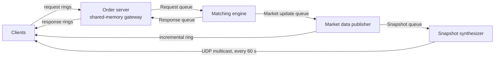

# Low-Latency Trading Exchange (C++20)

A simulated exchange in C++20 on Linux: a matching engine, an order server, and a market data publisher with incremental and snapshot streams. Clients send orders and read their responses and the incremental market data through shared memory, and snapshots go out over UDP multicast. In the benchmarks each component runs on its own isolated core, and they talk over lock-free single-producer, single-consumer queues.

## Status

| Part | Status |
| --- | --- |
| Matching engine and order book | Done, benchmarked on its own |
| Order server (shared-memory gateway) | Done, benchmarked end to end |
| Market data publisher, incremental stream (shared memory) | Done, benchmarked end to end |
| Snapshot synthesizer and snapshot stream (UDP multicast) | Built |
| Shared-memory transport (`common/shared-region.h`, order and market data channels) | Done |
| Building blocks in `common/` | Done |
| Trading client (market data consumer, order gateway, strategies) | To be completed |

## How it works



## Result

Wire to wire, the exchange answers a request in 0.72 µs at p50, 1.16 µs at p99 and 1.33 µs at p99.9, at 100,000 requests/s from 255 clients. Inside the matching engine alone, a request takes 90 ns at p50 and 288 ns at p99.

### Exchange, wire to wire

Microseconds, from a request being in its client's request ring in shared memory to its final response being in the client's response ring:

| mean | p50 | p90 | p99 | p99.9 |
| --- | --- | --- | --- | --- |
| 0.74 | 0.72 | 0.94 | 1.16 | 1.33 |

- **Workload:** 255 clients, each with its own slot in the order server's shared memory. 1,000,000 requests sent open loop at 100,000 a second for 10 s: request i is due at start + i / rate, whether or not earlier ones were answered. About 25% of requests cancel a random earlier order, which has often been filled already, the rest are new limit orders. Prices uniform in 1-256, quantities 1-1000, seed 42. The first 10% of requests are not measured.
- **Completeness:** all 1,000,000 requests answered, no sequence gaps, no lost market updates.
- **Setup:** client and exchange are separate processes on one machine, connected through shared memory, so no system call or network is in the path. Matching engine, order server, market data publisher and snapshot synthesizer each on an isolated core. The client's sender, response reader and market data reader on three more.

### Matching engine alone

Nanoseconds per request, from reading it off the request queue to having written and published every response and market update for it. Median of 5 runs, range in brackets:

| p50 | p90 | p99 | Throughput |
| --- | --- | --- | --- |
| 90 [90-95] | 171 [170-191] | 288 [286-318] | 131 ns per request, about 7.6M requests/s |

- **Workload:** 500,000 requests sent back to back, the first 50,000 skipped as warm-up. 8 instruments, 16 clients, prices 1-256, quantities 1-100, 25% cancels, seed 42. Stand-ins for the order server and market data publisher read the output queues, with a 16 µs busy wait per loop for their syscalls.

**Machine:** Intel i7-14650HX laptop, Ubuntu 26.04.1, CMake Release build (-O3), 2 MB pages for the shared memory and large heap allocations, no address randomisation. CPUs isolated with `isolcpus`, `nohz_full`, `rcu_nocbs`, `irqaffinity` and `nmi_watchdog=0`: CPUs 2-15 for the exchange run. Set up with `benchmarks/prepare-machine.sh` (below): uncore clock pinned, P-cores capped at 4.0 GHz, C1E promotion off, no idle state deeper than C1 on the CPUs that aren't isolated, fans at full speed.

## Measuring

**Matching engine benchmark**

- One RDTSC measurement per request, around processing and publishing. `scripts/perf-analysis.py` converts cycles to nanoseconds using the TSC frequency from the kernel log and prints count, mean and percentiles.
- Throughput is measured by the benchmark driver: the time from the first request sent to the last request's response, divided by the number of requests.

**Exchange benchmark**

- **Wire to wire:** `scripts/trace-analysis.py` measures the exchange's part of each request. The client notes when a request is in its ring, written to a file after the run. The order server logs a TSC timestamp when the final response is in the client's ring (`TRACE` in `common/perf-utils.h`, written by its async logger). The script joins the two by request and prints the mean and percentiles. The run script prints it after every run and records it in `results-exchange.csv`. These numbers are from the `shm-exchange-part` branch, where the trace points between the two are commented out: each cost the hot path a log line. The `shm-transport` branch keeps them, one per stage of a request's path, for a per-stage breakdown that includes their cost.

**Both** run scripts rebuild, run with a fixed memory layout, and append a row to their `results.csv` with the commit and a fingerprint of any uncommitted changes, so every recorded number can be traced to the code that produced it. The exchange benchmark's run script also appends the exchange's part to `results-exchange.csv`, with the same date and commit.

## Build and run

Requires Linux (thread pinning, 2 MB huge pages through hugetlbfs at `/dev/hugepages` for the shared memory, multicast on `lo` for snapshots), a C++20 compiler (built and measured with GCC 15.2), CMake 3.16+ and Python 3.

```bash
cd exchange/matching-engine
cmake -B cmake-build-release           # Release (-O3) unless CMAKE_BUILD_TYPE is set
cmake --build cmake-build-release -j   # exchange, exchange_benchmark, matching_engine_benchmark, exchange_main
```

From the repo root, once per boot:

```bash
sudo benchmarks/prepare-machine.sh   # pins the uncore clock, no deep idle and no C1E, caps the P-cores at 4.0 GHz, reserves the huge pages, Cooler Boost, checks the setup
```

Turning off C1E and turning on Cooler Boost write a CPU register and the laptop's embedded controller, which kernel lockdown refuses: Secure Boot has to be off, otherwise the script warns and leaves both as they are. Cooler Boost is for the MSI Katana 17 HX only, the script checks the embedded controller's firmware first.

The whole exchange, end to end:

```bash
benchmarks/exchange-benchmark/run-exchange-benchmark.sh                       # 255 clients, 100,000 requests/s, 10 s
benchmarks/exchange-benchmark/run-exchange-benchmark.sh --rate 200000 --clients 64
```

The matching engine alone:

```bash
benchmarks/matching-engine-benchmark/run-benchmark.sh
benchmarks/matching-engine-benchmark/run-benchmark.sh --price-min 101 --price-max 110   # dense book
```

## Limitations

- The order server drops a request that is out of sequence without a reject.
- A client that doesn't drain its response ring is dropped, and a market data reader that falls too far behind loses whole updates, which it sees as a gap in the sequence numbers.
- A slot isn't reused within a run: a client that disconnects can't reconnect until the exchange restarts.
- Limit orders and cancels only. No modify, market or IOC orders.
- No automated correctness tests yet.

## Next steps

- A trading client: a market data reader that builds the book from a snapshot plus the incremental stream, an order gateway, and a strategy.
- A deterministic correctness test: a fixed request stream checked against the expected fills and market updates.

## Credits

The architecture was originally inspired by Sourav Ghosh's *Building Low Latency Applications with C++* (Packt, 2023). After being optimised, most components no longer resemble their original counterparts.
